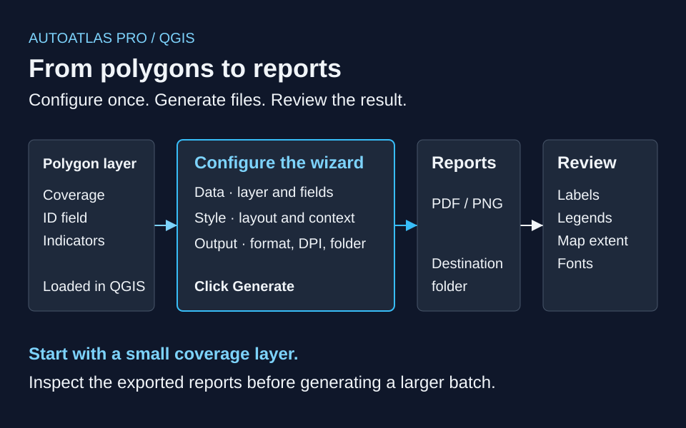

<p align="center">
  
</p>

# AutoAtlas Pro

**Automated Cartographic Report Generator for QGIS**

[](https://qgis.org)
[](https://doc.qt.io/qt-6/)
[](https://www.gnu.org/licenses/gpl-3.0)

---

## 🚀 What is AutoAtlas Pro?

Turn a polygon layer and its indicators into a series of **PDF or PNG cartographic reports**, with thematic maps, context layers and reusable layouts.

**[Install](#installation) · [Create your first report](#first-report) · [Features](#features) · [Architecture](#architecture)**

> **Repository version:** 1.3.0, marked experimental in [metadata.txt](metadata.txt). Its declared QGIS range is 3.34–4.99. The published plugin and this repository may differ; check the [official QGIS listing](https://plugins.qgis.org/plugins/autoatlas_pro/) for the release compatible with your QGIS version.

Perfect for:
- 📊 Census and demographic analysis
- 🏛️ Government municipal reports
- 🎓 Academic research
- 🌍 NGO territorial assessments

<a id="features"></a>
## ✨ Features

| Feature | Description |
|---------|-------------|
| **3-Step Wizard** | Intuitive guided workflow: Data → Style → Generate |
| **Dark Corporate UI** | Beautiful *Neo-Brutalist* Dark Theme with opacity micro-animations |
| **Smart Highlighting** | Automatically highlights the analyzed feature with a dashed outline against the context |
| **Context Layers** | Overlay additional reference layers (roads, rivers) with custom opacity and ordering |
| **Flexible Layouts** | Support for **A4 Vertical** and **A4 Landscape** orientations |
| **Magazine Styling** | High contrast palettes, Segoe UI typography and dynamic slate backgrounds for empty tiles |
| **Custom Branding** | Add your organization's **Logo**, custom title, and footer text |
| **Bilingual UI** | Instant switching between **English** and **Spanish** |
| **Batch safeguards** | Circuit-breaker and fallback handling for rendering failures; large batches still require monitoring |
| **PDF & PNG Export** | Configurable DPI (72–600 in the current wizard) |

<a id="installation"></a>
## 📦 Installation

### From QGIS Plugin Manager
1. Open QGIS → `Plugins` → `Manage and Install Plugins`
2. Search for "AutoAtlas Pro"
3. Check the offered version and compatibility, then click **Install Plugin**.

The plugin is listed in the [official QGIS repository](https://plugins.qgis.org/plugins/autoatlas_pro/). Installing that release is different from installing the development version below.

### Manual Installation
1. Download or clone this repository
2. Place the repository contents in a folder named `autoatlas_pro` inside the active QGIS profile's `python/plugins/` directory. `metadata.txt` and `__init__.py` must be directly inside that folder. Typical **default profile** locations are:
   - **Windows**: `%APPDATA%\QGIS\QGIS3\profiles\default\python\plugins\`
   - **macOS**: `~/Library/Application Support/QGIS/QGIS3/profiles/default/python/plugins/`
   - **Linux**: `~/.local/share/QGIS/QGIS3/profiles/default/python/plugins/`
3. Restart QGIS and enable **AutoAtlas Pro**. The repository version is experimental, so check the administrator's experimental-plugin filter if necessary.

On first launch, the plugin may offer optional Python dependencies for statistics and chart export. Review that dialog before installing packages into QGIS's Python environment.

<a id="first-report"></a>
## 📖 Create your first report



Load a polygon layer in QGIS, configure **Data → Style → Output**, then generate
PDF or PNG files and review them before scaling up. The diagram uses the plugin's
colors and Segoe UI typography, with system-font fallbacks.
[Editable diagram source](docs/readme/report-workflow.html).

1. **Load** a vector layer with polygon geometries (e.g., communes, districts)
2. **Open** AutoAtlas Pro from the Plugins menu or toolbar
3. **Step 1 (Data)**: Select your coverage layer, ID field, and indicator fields.
4. **Step 2 (Style)**: 
    - Configure the **Language** (ES/EN) and **Template** (Vertical/Horizontal).
    - Add your **Logo** and custom titles.
    - Set up **Context Layers** to provide geographical reference.
    - Customize map style/colors.
5. **Step 3 (Output)**: Set output format (PDF/PNG), DPI, and destination folder.
6. **Click Generate**, then inspect the exported files in the destination folder.

**Start small:** use a small coverage layer and moderate DPI for the first run. Check labels, legends, map extent, fonts and output before generating a large batch. Runtime depends on feature count, layer complexity, external map providers, DPI and hardware; there is no fixed throughput guarantee.

| Input | Result |
| :--- | :--- |
| Polygon coverage layer + ID + indicator fields | One report workflow driven by the selected coverage data |
| Layout, branding and context layers | Consistent map presentation across the batch |
| Output folder, PDF/PNG and DPI | Files ready for review and distribution |

<a id="architecture"></a>
## 🏗️ Architecture

```
autoatlas-pro/
├── plugin.py              # QGIS plugin lifecycle
├── core/
│   ├── models.py          # Strict-typing dataclasses
│   ├── data_engine.py     # Statistics & rankings
│   ├── map_renderer.py    # Thematic map generation
│   ├── chart_engine.py    # Dual-backend charts
│   ├── report_composer.py # Resilience & Pipeline orchestration
│   └── dependency_manager.py
├── ui/
│   ├── wizard_controller.py # Logic delegation (MVC)
│   ├── wizard_dialog.py   # PyQt Dark Corporate UI
│   ├── theme.py           # QSS Global Stylesheet
│   └── dependency_dialog.py
├── templates/             # Premium layout definitions
└── i18n/                  # Translation files
```

## 📄 License

This plugin is licensed under the [GNU General Public License v3.0](LICENSE). See [CHANGELOG.md](CHANGELOG.md) for release notes.

## 🤝 Contributing

Contributions are welcome! Please open an issue or pull request on GitHub.
